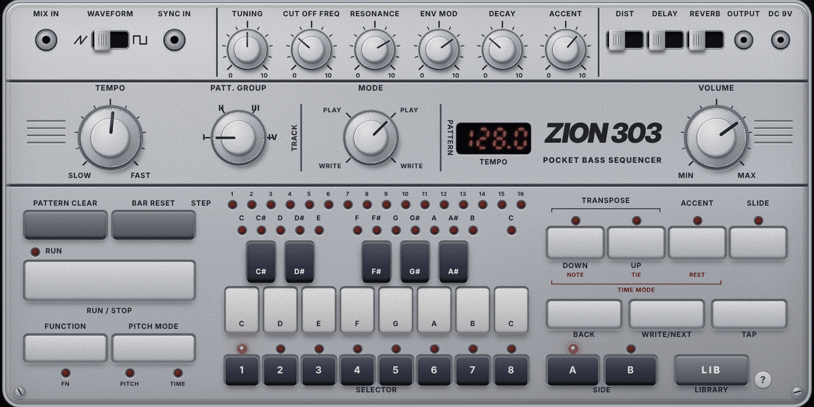
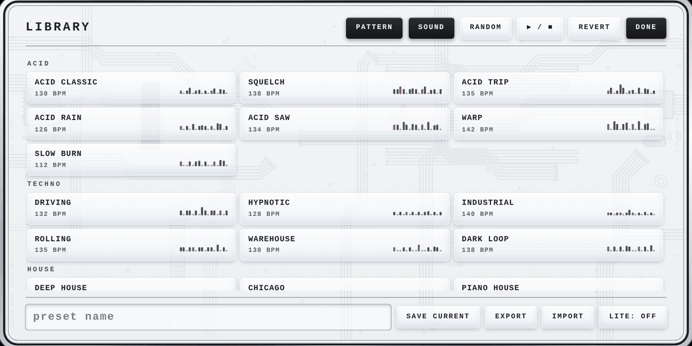
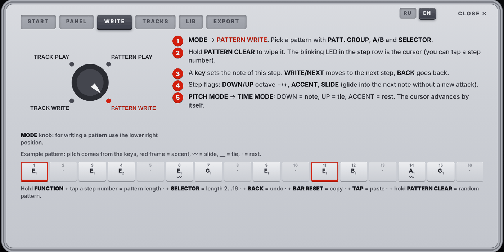
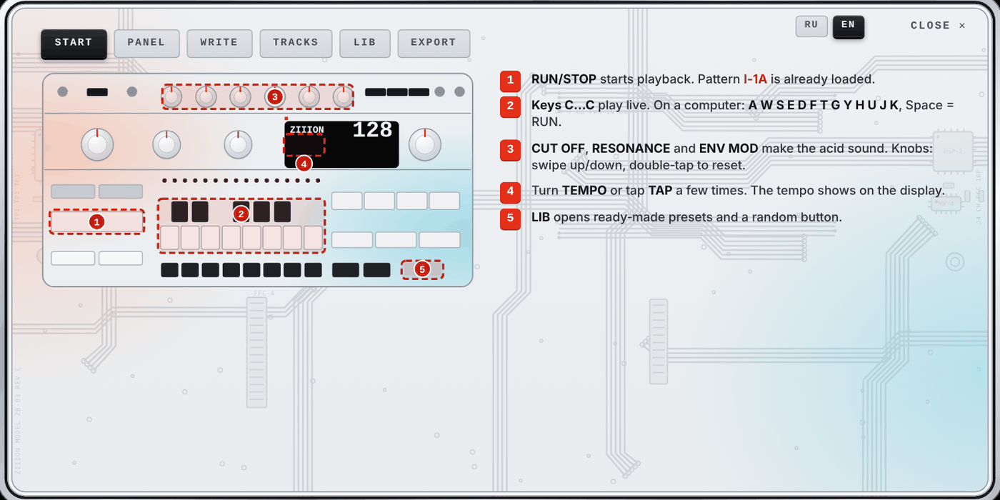

# ZION 303

A pocket bass-line synthesizer and step sequencer for the phone browser — a skeuomorphic homage to the classic Roland TB-303 / TB-03 panel. One HTML file, no dependencies, works offline as a PWA.

**▶ Live demo: https://shoogaze.github.io/zion-bass-303/**

Open it on your phone or computer, tap once to start the audio. Add to Home Screen to use it as an app.

> ZION 303 is an independent project inspired by the TB-303 design. It is not affiliated with or endorsed by Roland. "Roland" and "TB-303" are trademarks of their respective owners.



| Library | Tutorial: writing | Tutorial: start |
|---|---|---|
|  |  |  |

## Features

- **Voice** — PolyBLEP saw / square, 4× oversampled 24 dB ladder filter with resonance, envelope modulation, accent sweep and slide, running in an AudioWorklet.
- **Sequencer** — the 303 way: 64 patterns (4 groups × A/B × 8), 16 steps with note / tie / rest, octave down/up, accent and slide; 8 tracks of pattern chains; copy / paste / undo.
- **Effects** — distortion, ping-pong delay (3/16), stereo reverb.
- **Library** — 32 musical presets (pattern + tempo + sound) across Acid, Techno, House, Electro, Rave, Dub and Ambient, a random generator, your own saved presets with JSON import / export.
- **Export** — WAV loop (with effect tails) and MIDI file (accents as velocity, slides as legato).
- **Interface** — red 7-segment BPM display, tap tempo, multi-touch keys, built-in tutorial in English and Russian (`?` button, RU / EN switch), portrait mode rotates the panel.
- **Performance** — knobs have some weight (slow drags are fine-grained, fast ones coarse). **LITE mode** (LIB → LITE) drops the grain texture, blurs and glows and halves the filter oversampling; it is on by default on iPhone.
- **PWA** — add to Home Screen on iPhone / Android; works offline after the first visit.

## Install on iPhone

1. Open the live demo in Safari.
2. Share → **Add to Home Screen**.
3. Launch it from the icon: fullscreen, works offline. Turn the phone sideways (portrait rotates the panel automatically).

## Quick start

1. Open the page and tap the screen to start the audio.
2. Press **RUN/STOP** — pattern I‑1A is already loaded.
3. Turn **CUT OFF**, **RESONANCE** and **ENV MOD**. Knobs: swipe up/down, double-tap to reset.
4. Open **LIB** for presets and the random button.

Computer keyboard: `A W S E D F T G Y H U J K` play the keys, `Space` toggles run.

## Project layout

```
index.html          built single-file app (this is what GitHub Pages serves)
sw.js               optional offline cache for http(s)
build.py            assembles src/ into index.html
src/
  template.html     page shell
  worklet.js        AudioWorklet DSP: voice, filter, sequencer, delay, reverb
  css/              styles, concatenated in filename order
  js/               app code, concatenated in filename order inside one scope
    00-core 05-view 10-data 20-engine 25-osd 30-chassis 35-knobs 40-buttons
    45-top-band 48-i18n 50-library 60-mid-band 65-bpm-display 70-bottom-band
    80-tutorial 85-export 90-logic 92-live-keys 93-leds 94-computer-keyboard
    96-pwa 99-boot
  fonts/            wordmark font (subset) + its licence
  icons/            app icon (svg + 180/192/512 png; 512 is inlined at build)
tests/              Playwright smoke tests (UI logic, export)
screenshots/
```

## Build

No dependencies, just Python 3:

```
python3 build.py
```

then open `index.html` or serve the folder (`python3 -m http.server 8000`).

## Tests

```
npm i playwright
node tests/ui.test.js
node tests/export.test.js
```

Set `CHROME_PATH` to use a system Chrome instead of Playwright's browser.

## Deploy to GitHub Pages

The repository is `SHOOGAZE/zion-bass-303`. Push it, then Settings → Pages → Deploy from a branch → `main` / root. `.nojekyll` is included.

## Fonts

Panel text uses the system Helvetica Neue / Arial stack. The ZION wordmark uses Inter Display Black Italic (Latin subset, embedded), © The Inter Project Authors, SIL Open Font License 1.1 — see `src/fonts/LICENSE-Inter.txt`.

## Controls at a glance

| Control | What it does |
|---|---|
| RUN/STOP | start / stop playback |
| MODE knob | track / pattern, play / write |
| PATT. GROUP, A/B, SELECTOR | choose the pattern |
| Keys, WRITE/NEXT, BACK | enter notes step by step |
| DOWN / UP, ACCENT, SLIDE | step flags |
| FUNCTION + step / SELECTOR / BACK | length, undo, copy, paste |
| LIB | presets, random, your own presets |

Full walkthrough: the `?` button inside the app.

## License

MIT © Kirill Kinderhart (code). Embedded font: see above.

---

## По-русски

Карманный бас-синтезатор и секвенсор в духе Roland TB‑303: один HTML-файл, работает офлайн, ставится на экран «Домой». Внутри 32 готовых пресета (паттерн + темп + звук), рандом, экспорт WAV и MIDI, встроенная справка на русском и английском (кнопка `?`). Сборка: `python3 build.py`.
